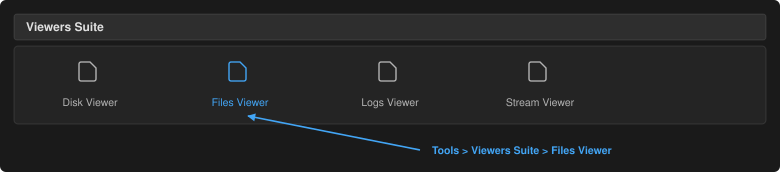
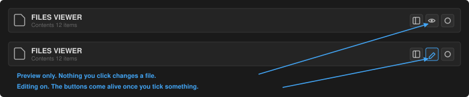
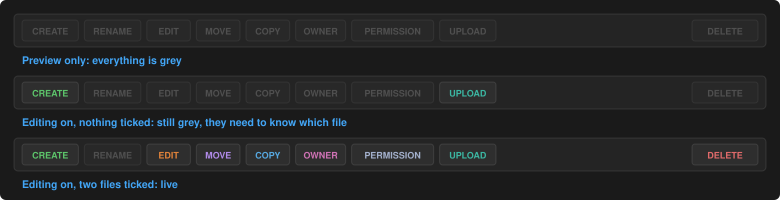
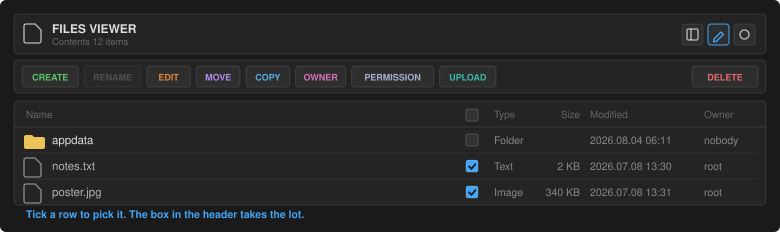
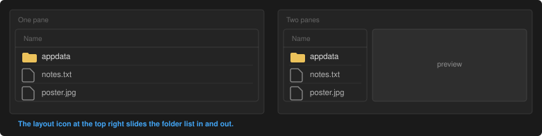
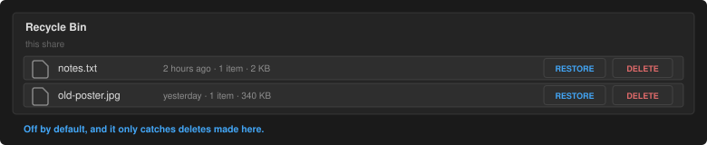
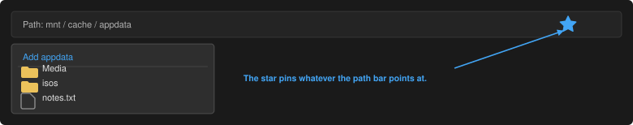
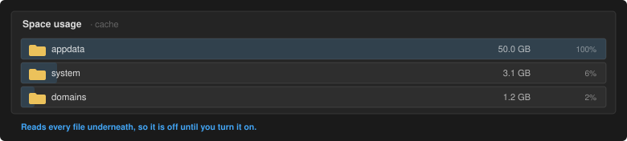

# Files Viewer, a short guide

Everything here happens on one page. This walks through the parts that are not
obvious the first time.

## Finding it

**Tools > Viewers Suite > Files Viewer**

There is also a stacked-pages icon in the top bar of the webGUI that jumps
straight there.

Settings live separately, under **Settings > Files Viewer**.

## Looking versus changing

This is the one thing worth reading. Files Viewer opens in **preview only**. In
that state you can browse, read, play and download, and nothing you click will
change a file.

The eye icon at the top right switches it. When editing is on the icon becomes a
pencil, and Create, Rename, Move, Copy, Owner, Permission and Delete come alive.

Turning editing on is not enough on its own. Most of those buttons also need to
know **which** file you mean, so they stay grey until you tick something. The
exceptions are Create and Upload, which act on the folder you are in and need no
selection.

## Picking files

With editing on, every row grows a tick box. Tick one for Rename, tick as many as
you like for Delete, Copy, Move, Owner and Permission.

The header tick box selects everything in the folder.

## One pane or two

The plugin opens with a single pane: the folder fills the window as a table with
type, size, date, owner, group and mode.

The icon at the top right slides out the older folder list alongside it. That
view keeps the preview on the right, so you see a file while you work. It
remembers whichever you left it on.

## Opening things

Click a file and it opens in place. Text and code arrive with syntax
highlighting, Markdown rendered, images, audio, video and PDF shown directly.
Word documents, spreadsheets, CSV, e-books and fonts open too. Zip and tar
archives are listed without unpacking, and SQLite databases open read-only with
a table picker.

Click the file again, or press Escape, to close it.

## Editing a file

With editing on, open a text file and press **Edit**. Save writes it back in one
step, so a power cut cannot leave half a file behind. The editor takes files up
to 2 MB, whatever the preview limit is set to.

If Edit stays grey on a file that previews fine, hover it and the button says
why.

## Deleting

Delete removes what you have ticked. If the recycle bin is switched on in the
settings, deletes made here move to a per-share bin instead of going for good,
and the Recycle Bin button restores or empties them.

The bin is off by default, and it only covers deletes made inside Files Viewer.
Anything deleted over SMB or by another tool is not caught.

## Uploading and downloading

Upload sends files into the folder you are in, in chunks, so size limits are not
a problem, and it can be cancelled mid-transfer. Download pulls out the file you
have open or the single file you have ticked.

## Favourites

The star in the path bar pins the folder or file you are looking at. The
Favourites button lists them, and clicking one jumps straight there. They are
kept on the server, so they follow you to any browser.

## Folder sizes

A folder has no size until something reads every file underneath it. In the
single pane view, folders show a **Measure** button in the size column that does
exactly that, for that folder only.

The Space button does the same for a whole folder and ranks what is inside it by
what it takes up. Both are off until you turn Space on in the settings, because
on a share with hundreds of thousands of files they run for many minutes.

## Where it can go

Files Viewer works inside `/mnt` and nowhere else. Every disk, pool and share is
reachable; nothing above `/mnt` ever is. The mount points themselves, `/mnt/user`
and the pools and disks, can be browsed and copied but not renamed, moved or
deleted.

Browsing reads directory entries and metadata only, so it never wakes a sleeping
disk. Opening a file wakes just the disk holding it.

Every write is logged to `/var/log/filesviewer.log` with the time, the action and
the paths involved.
