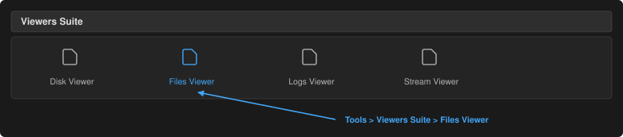
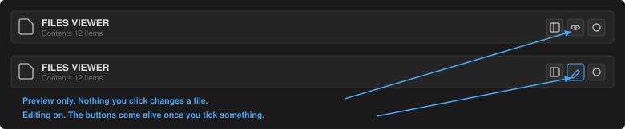
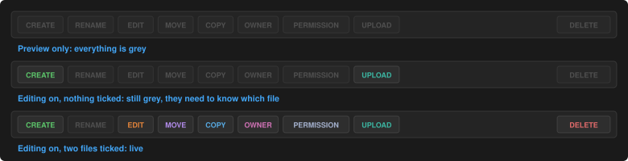
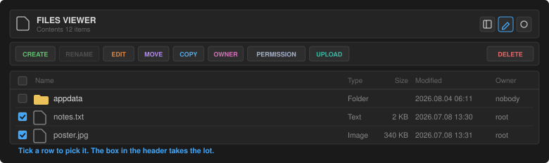
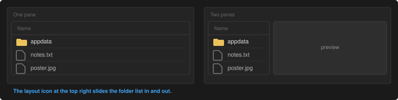
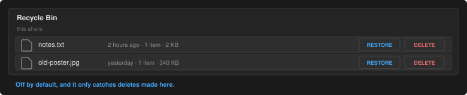
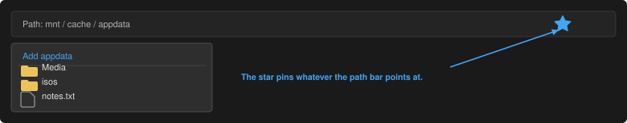
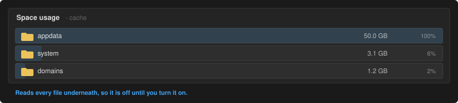

# Files Viewer, a short guide

Everything here happens on one page. This walks through the parts that are not
obvious the first time.

## Finding it

**Tools > Viewers Suite > Files Viewer**

There is also a stacked-pages icon in the top bar of the webGUI that jumps
straight there.

Settings live separately, under **Settings > Files Viewer**. If a custom theme
makes the page come out light on a dark theme, or the other way round, the
Palette setting under Appearance locks it to the one you actually see.

## Looking versus changing

This is the one thing worth reading. Files Viewer opens in **preview only**. In
that state you can browse, read, play and download, and nothing you click will
change a file. If you mostly come here to upload or delete, the Open in setting
under Browsing starts it in editing instead.

The eye icon at the top right switches it. When editing is on the icon becomes a
pencil, and Create, Rename, Move, Copy, Owner, Permission and Delete come alive.

Turning editing on is not enough on its own. Most of those buttons also need to
know **which** file you mean, so they stay grey until you tick something. The
exceptions are Create and Upload, which act on the folder you are in and need no
selection.

When the window is too narrow for the button labels, the buttons show only their
icons. Hover one for its tooltip.

## Picking files

With editing on, every row grows a tick box. Tick one for Rename, tick as many as
you like for Delete, Copy, Move, Owner and Permission.

The header tick box selects everything in the folder. Shift-click a tick box to
tick everything between it and the last one you ticked. With no file open,
Ctrl+A ticks the whole folder, Delete asks to delete what is ticked, and F2
renames the one ticked item.

## One pane or two

The plugin opens with a single pane: the folder fills the window as a table with
type, size, date, owner, group and mode. Click a column header to sort by it,
and again to flip the direction. The order you pick is kept in that browser,
the Sorting section of the settings sets the default everywhere else.

The icon at the top right slides out the older folder list alongside it. That
view keeps the preview on the right, so you see a file while you work. It
remembers whichever you left it on.

## Opening things

Click a file and it opens in place. Text and code arrive with syntax
highlighting, Markdown rendered, images, audio, video and PDF shown directly.
Word documents, spreadsheets, CSV, e-books and fonts open too. Zip and tar
archives are listed without unpacking, and SQLite databases open read-only with
a table picker.

Click the file again, or press Escape, to close it.

An open image has a **Full screen** button above it. The whole screen goes to
the image, the arrows at the sides, the arrow keys or a tap near an edge move
to the other images in the folder, in the order the list shows them, and
Escape brings you back with the last one you looked at open in the preview.

## Compressing

Tick files or folders, press **Compress**, give the archive a name and pick zip
or tar.gz. It lands next to the items, and if the name is taken it gets a number
in brackets. Links are left out. With only archives ticked the button stays
grey, there is no point packing a zip into another zip.

## Extracting an archive

Open a zip or tar archive and, with editing on, press **Extract** above the
listing. It unpacks next to the archive. An archive that holds a single file or
a single folder gives you that file or folder as it is, anything more lands in
a new folder named after the archive. A name that is already taken gets a
number, the way a move does. Links inside the archive are left out, and what
comes out takes the owner and permissions of the folder it lands in, not
whatever the archive says. 7z and rar are listed as unsupported, because they
need tools that stock Unraid does not ship.

## Long jobs

Copy, move, extract, compress and checksum run in the background with a
progress bar and a Cancel button. One that runs longer than a minute ends with
an Unraid notification saying how it went, so you can leave the page. The
Notifications section of the settings switches that off.

## Editing a file

With editing on, open a text file and press **Edit**. Save writes it back in one
step, so a power cut cannot leave half a file behind. The editor takes files up
to 2 MB, whatever the preview limit is set to.

If Edit stays grey on a file that previews fine, hover it and the button says
why.

The editor shows line numbers and where the cursor is. **Find**, or Ctrl+F,
opens a bar above the text: Enter steps to the next match, Shift+Enter to the
previous, Aa makes it case sensitive, and the second field with Replace or
Replace all changes them. Ctrl+S saves without reaching for the button, and
Tab puts a tab in the file rather than moving the focus away.

## Unraid defaults

Half the trouble with appdata and shares written by containers is ownership.
Both the Owner and the Permission dialogs carry an **Unraid defaults** button
that sets nobody:users, folders 777 and files 666 on the ticked items and
everything inside them. That is what New Permissions in Tools does for a whole
share, here it stops at what you picked. Links are left alone.

## Checksums

**Checksum** in the bar above the preview computes the SHA256, SHA1, MD5 or
SHA512 of the open file, or of the one file you have ticked, in the background,
with a progress bar and Cancel for the big ones. Copy takes the result to the
clipboard, and pasting the checksum from a download page into the field below
says whether it matches.

## Deleting

Delete removes what you have ticked. If the recycle bin is switched on in the
settings, deletes made here move to a per-share bin instead of going for good,
and the Recycle Bin button restores or empties them.

The bin is off by default, and it only covers deletes made inside Files Viewer.
Anything deleted over SMB or by another tool is not caught.

## Uploading and downloading

Upload sends files into the folder you are in, in chunks, so size limits are not
a problem, and it can be cancelled mid-transfer. Download pulls out the file you
have open or the single file you have ticked. Tick several files, or a folder,
and Download packs them into one zip on the way to the browser. Nothing is
written on the server, so the browser cannot show a total size while it comes
down, and links are left out.

**Copy path**, in the bar above the preview, puts the path of the one item you
have ticked, else of the open file, else of the folder you are in, on the
clipboard. **Open raw** opens the open or ticked file in a new tab, as the
browser would show it on its own.

## Searching

**Search** in the bar looks through every folder below the one you are in, or
below the one folder you have ticked. Type part of a name, or a pattern like
`*.mkv` or `IMG_2024*`, and press Enter. The count ticks up while it runs and
Cancel stops it. Click a result to go to it. Escape closes the pane, and when
you come back to Search the last results are still there.

The filter box above the table is a different thing: it only narrows the rows
you already see, and never looks inside the folders.

## Which disk

**Which disk**, in the bar above the preview, names the disk or pool behind
the ticked item, the open file or the folder you are in, with the drive's
identification, device, size, filesystem and temperature, the way the Main
page shows them. On a pool it lists the member drives too.

A path under `/mnt/user` is really on one of the disks or pools, and for a
folder usually on several, so there the button looks for the same path on
each of them first and lists where it sits, with a click to open that copy.
It asks before looking, because a disk that is asleep may wake up.

If a file turns up on more than one disk, that is worth knowing: `/mnt/user`
shows only one of them, the others are stale copies taking space.

## Favourites

The star in the path bar pins the folder or file you are looking at. The
Favourites button lists them, and clicking one jumps straight there. They are
kept on the server, so they follow you to any browser.

## Folder sizes

A folder has no size until something reads every file underneath it. In the
single pane view, folders show a **Measure** button in the size column that does
exactly that, for that folder only.

The Space button does the same for a whole folder and ranks what is inside it by
what it takes up. It takes the one folder you have ticked, or the folder you are
in when nothing is, and Escape closes it. Both are off until you turn Space on
in the settings, because on a share with hundreds of thousands of files they
run for many minutes.

## Where it can go

Files Viewer works inside `/mnt` and nowhere else. Every disk, pool and share is
reachable; nothing above `/mnt` ever is. The mount points themselves, `/mnt/user`
and the pools and disks, can be browsed and copied but not renamed, moved or
deleted.

Browsing reads directory entries and metadata only, so it never wakes a sleeping
disk. Opening a file wakes just the disk holding it.

Every write is logged to `/var/log/filesviewer.log` with the time, the action and
the paths involved.
