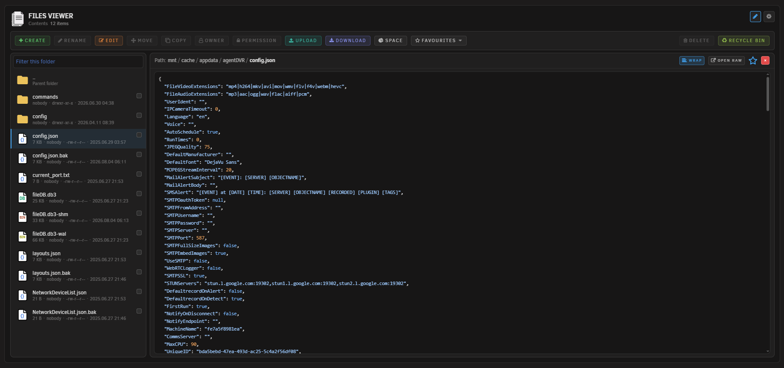
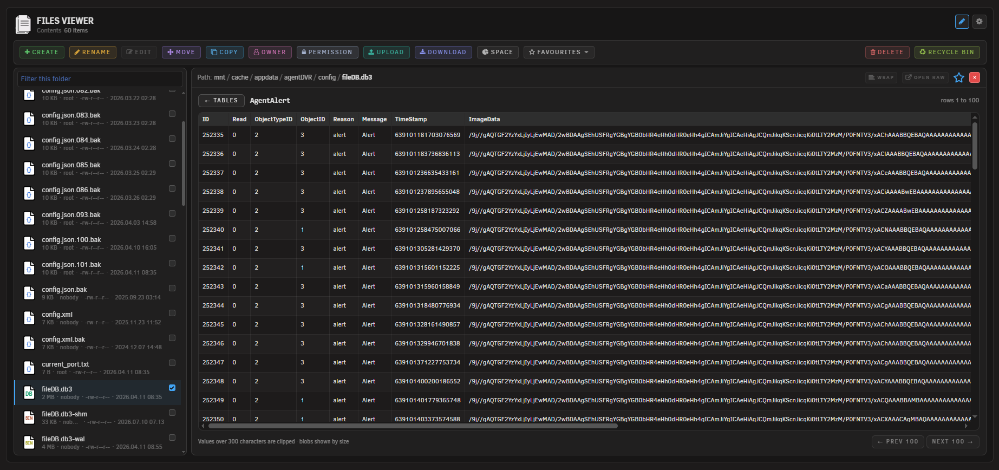
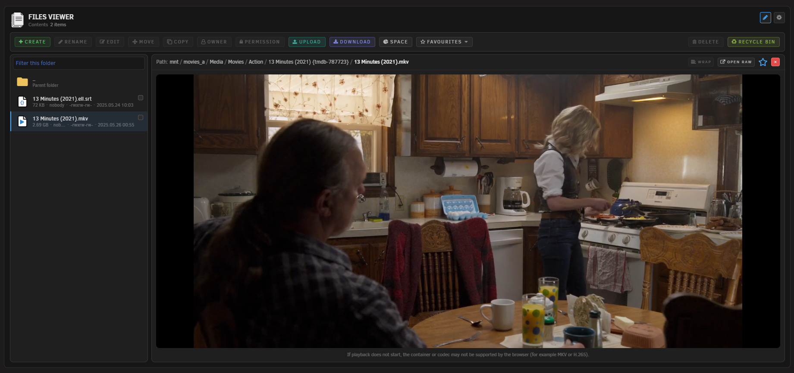
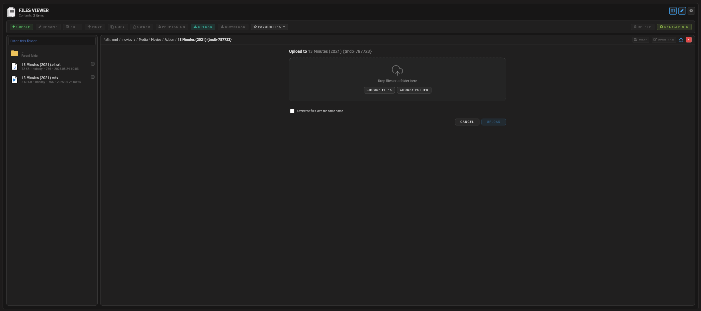
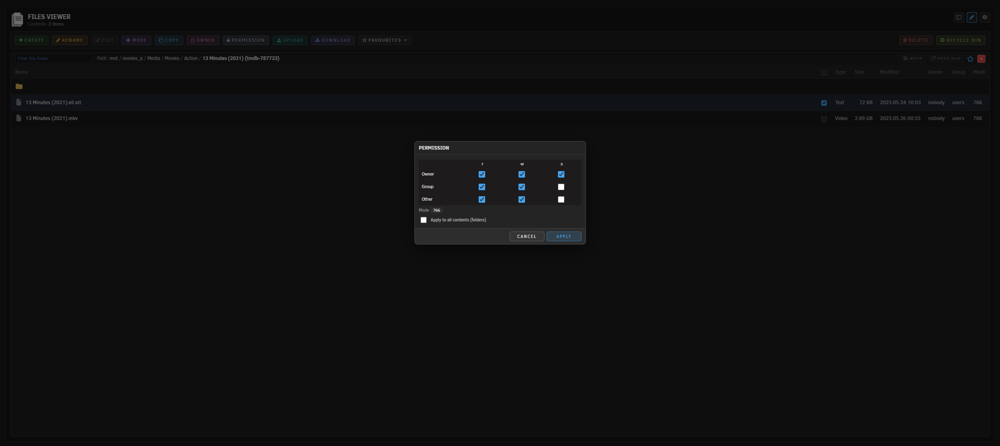
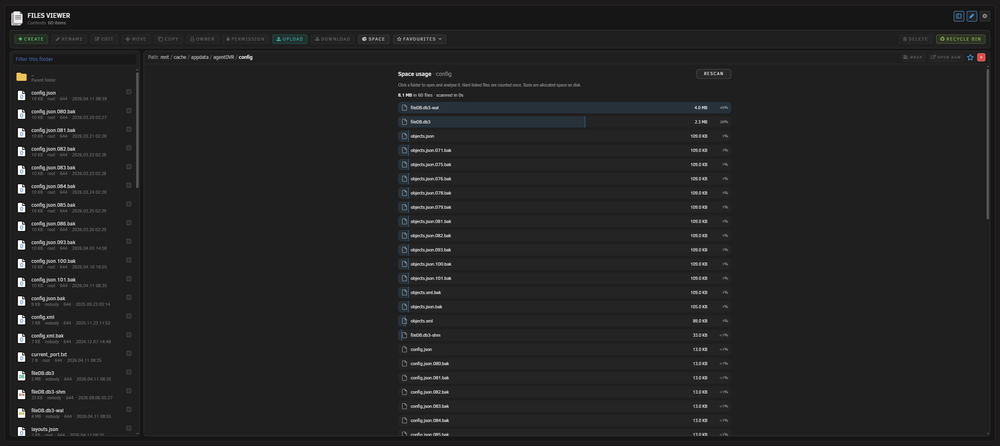
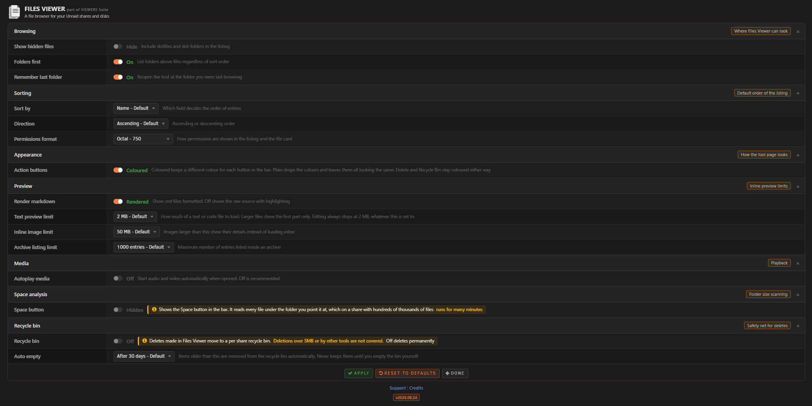

# Files Viewer for Unraid

Browse your Unraid shares and disks from a page under Tools, preview files in place, and manage them without leaving the browser. Turn on the recycle bin and deletes land in a per-share bin instead of vanishing.

<p align="center">
  &nbsp;
  &nbsp;
  &nbsp;
  &nbsp;
  
</p>

## What it does

Unraid's built-in File Manager is great for moving files around, but it shows "Unsupported Preview" for most file types. Files Viewer started as its read-only companion and grew into a manager of its own: a page under Tools where the folder fills the window, or splits into a list and a preview if you prefer, with everything you can do to a file in the bar above.

It previews the common types in place: images, text and code with syntax highlighting, Markdown, audio and video, and PDF, and it lists the contents of zip and tar archives. Richer formats open too: SQLite databases, Word documents, spreadsheets, CSV as a table, fonts, and e-books. On the writing side it covers the everyday jobs: create, rename, edit, move, copy, upload, download, ownership, permissions, and delete, and it packs and unpacks zip and tar archives. It opens in preview only, where nothing you click can change a file, and switches to editing with one click, or starts there if you prefer. It speaks the language set in Unraid.

## Features

- Tools Page: A full-page browser under Tools > Viewers Suite > Files Viewer. By default the folder fills the window as a table, and the icon at the top right slides out the folder list beside it when you want both. It stays where you left it
- Rooted at /mnt: Browsing starts at /mnt and stays inside it, so every disk, pool, and share is reachable in one place and nothing above /mnt is
- Folder table: Name, type, size, modified time, owner, group and mode, with a header that stays put while you scroll. Click a folder to open it, a file to preview it. With editing on, a tick box before each name picks items for the bar
- Preview only by default: The eye icon at the top right keeps every write action off until you switch it to the pencil, so browsing can never change a file by accident. If you mostly come to upload or delete, the Open in setting starts the tool in editing
- Measure a folder: Folders have no size until something reads them, so the size column offers a Measure button that works out what one holds. It is the same scan the Space button runs, for that folder only, and appears only when Space is turned on
- Write operations: Create files and folders, rename, move, copy, delete, and change owner or permissions from the top bar
- In-place editor: Open text and config files up to 2 MB in the preview pane, change them, and save them back. Line numbers, cursor position, find and replace with Ctrl+F, Ctrl+S to save
- Upload and download: Send files from your machine to the current folder, cancel midway if you change your mind, and pull any file back out
- Background jobs: Long copies, moves, deletes, extractions and compressions run in a worker with live progress and a cancel button, so the page never hangs
- Recycle bin: Deletes made in Files Viewer move to a per-share bin, with restore and purge in a bin view and a daily auto-empty (30 or 60 days, or never). A tick in the Delete dialog skips the bin for that one delete
- Bin off the network: The bin is reachable from this page alone. Samba vetoes the folder on every share and it is root-only on disk, which covers NFS as well
- Space analysis: Rank everything inside a folder by the space it actually takes, with drill-in on the results. It reads every file underneath, which on a share with hundreds of thousands of files runs for many minutes, so the button is hidden until you turn it on in the settings
- Audit log: Every write is appended to /var/log/filesviewer.log with the time, the action, and the paths involved
- Image preview: View images inline, fitted or at actual size with drag to pan, up to a configurable size limit, or full screen with arrows and keys to walk through the folder
- Text and code preview: Read text and code with syntax highlighting, long lines wrapped by default with a toggle, capped so large files stay responsive
- Markdown preview: Render Markdown formatted, with a toggle to see the raw source
- Audio and video: Play media inline with the browser's own player and byte-range seeking. Formats the browser cannot decode fall back to details
- PDF preview: View PDFs inline in the browser's own viewer, with byte-range loading
- Archive contents: List what is inside zip and tar archives (including tar.gz, tar.bz2, tar.xz) without extracting anything
- Compress: Pack the ticked files and folders into a zip or tar.gz next to them, with progress and cancel. Both are written by the plugin itself, streamed file by file, so a large set gets a bar instead of a frozen page, and zip handles files over 4 GB
- Extract: Unpack a zip or tar archive next to it, with progress and cancel. The dialog says what is inside and proposes the name, which can be changed: a single file or folder comes out as itself, anything more goes into a folder named after the archive. Entries are checked one by one, links are left out, and what comes out takes the owner and permissions of the folder rather than whatever the archive says. 7z and rar are not covered, they need tools that stock Unraid does not ship
- Database browser: Open SQLite databases (.db, .db3, .sqlite) read-only, pick a table, and page through the rows 100 at a time
- Document and spreadsheet preview: Render Word documents (.docx) as formatted text, and show spreadsheets (.xlsx, .xls, .ods) as a table with a tab per sheet
- Table view for CSV: Show CSV and TSV as a table by default, with a toggle back to the raw text
- Font preview: View a specimen of a font file (.ttf, .otf, .woff, .woff2) at several sizes
- E-book preview: Read .epub books in place with previous and next
- Light on the page: The richer previews load their viewer only the first time one is needed, and each has its own size limit
- Disk friendly browsing: Listing folders reads directory entries and metadata only, so browsing never wakes a sleeping disk. Opening a file reads its content, which wakes the disk that holds it
- Favourites: Pin any folder or single file with the star in the path bar and jump straight back to it from the Favourites button. They live on the flash drive, so they follow you to any browser, and anything you delete drops off the list on its own
- Breadcrumb navigation: Click any part of the path to jump back up, with an Up row inside each folder
- Folder-aware sorting: Sort by name, size, or modified time, ascending or descending, with folders kept first if you want. In the table a click on any column header sorts by it and a second click flips it, kept per browser
- Quick filter and keyboard: Type to filter the current folder by name, move with the arrow keys, and open with Enter. The filter sits in the path bar with one pane and in the folder list with two. Shift-click ticks a range, Ctrl+A ticks the folder, Delete and F2 do what the buttons do
- Zip download: Tick several files, or a folder, and Download streams them to the browser as one zip, built on the way out with nothing written on the server
- Job notifications: A copy, move, extract, compress or checksum that runs longer than a minute ends with an Unraid notification, so the page can be left. Off in the settings if you prefer
- Copy path: One button in the preview bar puts the path of the ticked item, the open file or the current folder on the clipboard
- Search: Look through every folder below the current one by part of a name or a shell pattern, in the background with a running count and Cancel, results a click away
- Which disk: Name the disk or pool behind a file or folder, with the drive's identification, size, filesystem and temperature. Under /mnt/user it finds which disks and pools hold the path and opens that copy directly, asking first since a sleeping disk may wake up, and flags a file that sits on more than one disk
- Unraid defaults: One button in the Owner and Permission dialogs sets nobody:users, folders 777 and files 666 on the ticked items and everything inside, the New Permissions recipe applied to a selection
- Checksum: SHA256, SHA1, MD5 or SHA512 of the open or ticked file, computed in the background with progress and Cancel, with copy and a field that checks a pasted checksum against it
- Remembers your place: Reopens at the folder you were last browsing, which you can turn off
- Theme-aware: Follows the active Unraid theme, with its own palette for each of Black, White, Azure and Gray rather than one light and one dark. A custom theme that restyles the GUI without changing the theme setting can leave the page light on a dark screen, so the Palette setting locks it to dark or light
- Translated: Every string goes through Unraid's translation layer, so the plugin appears in the language set in Display Settings once the language pack carries its strings. Greek, German and French are ready, see Languages below
- Settings Page: Standalone settings at Settings > Files Viewer with browser-native form submission

## Languages

The plugin follows the language set in Unraid. Greek, German and French are in
[languages/](languages/), ready for the Unraid language packs, which is where
Unraid reads plugin translations from. Until a pack carries them, those users see
English. [languages/README.md](languages/README.md) has the details, and how to
add another language.

## Guide

A short walkthrough of the parts that are not obvious the first time, including
the difference between preview and editing, is in [GUIDE.md](GUIDE.md).

## Scope and limits

Files Viewer works inside /mnt and nowhere else, reading and writing alike. The mount points themselves, /mnt/user, the pools and the disks, can be browsed and copied but not renamed, moved or deleted, since removing one would empty everything it holds. A folder with more items than the listing carries shows the first few thousand and says so at the bottom of the list. Every path is resolved and checked on the server before anything happens, and every write is logged. The recycle bin only catches deletes made in Files Viewer; deletions over SMB or by other tools bypass it, and turning the bin off makes deletes permanent. Most rich formats are parsed in the browser from the file's own bytes; SQLite is the exception and is opened read-only on the server. Listing and extraction for 7z and rar are not included, since those need extra tools that are not assumed to be present; those files show their details with a download instead. Extracting refuses any entry that would land outside the new folder and leaves links out, and compressing leaves links out as well. Video that uses a container or codec the browser cannot decode (for example MKV or H.265) also falls back to details.


**Walkthrough**

A video by [Sascha Brockel](https://www.youtube.com/@saschabrockel), with Files Viewer as the main focus. Thanks Sascha.

The video is in German. YouTube can auto-translate the subtitles, so you can follow it in your own language.

[](https://www.youtube.com/watch?v=MTUURZIZWWQ)


**Tool page Screenshots**








## Requirements

- Unraid 7.2.0 or later

## Installation

**Via Community Applications (recommended)**
1. Open Community Applications in Unraid
2. Search for Files Viewer
3. Click Install

**Manual Installation**
1. Go to Plugins in Unraid
2. Click Install Plugin
3. Paste the following URL and click Install:
   ```
   https://raw.githubusercontent.com/Lazaros-Chalkidis/unraid-filesviewer/main/filesviewer.plg
   ```

After installing, open Tools > Viewers Suite > Files Viewer. Tune the behaviour under Settings > Files Viewer.

**Removing it**

Removing the plugin leaves your settings and your recycle bins where they are, so reinstalling picks up exactly where you left off. If you want the bins gone as well, the uninstall prints the command to do it.

## Settings

**Settings > Files Viewer**

**Browsing**
- Show hidden files: Include dotfiles and dot-folders in the listing
- Folders first: List folders above files regardless of sort order
- Remember last folder: Reopen the tool at the folder you were last browsing (on by default)
- Open in: Preview only, or Editing with the write actions already live (preview only by default)

**Sorting**
- Sort by: Name, Size, or Modified. A click on a column header in the table overrides this for that browser
- Direction: Ascending or Descending
- Permissions format: Show permissions as octal (750) or symbolic (drwxr-xr-x)

**Appearance**
- Action buttons: Coloured keeps a different colour for each button in the bar, Plain drops the colours. Delete and Recycle Bin stay coloured either way
- Palette: Follow the Unraid theme, or lock the plugin to dark or light. A custom theme changes the page without changing the theme setting the plugin follows, so this is the fix for one that comes out wrong

**Preview**
- Render markdown: Show .md files formatted, or off to show the raw source
- Text preview limit: How much of a text or code file to load (default 2 MB). Editing is separate and always stops at 2 MB, whatever this is set to
- Inline image limit: Images larger than this show their details instead of loading inline (default 50 MB)
- Archive listing limit: Maximum number of entries listed inside an archive (default 1000)

**Media**
- Autoplay media: Start audio and video automatically when opened (off by default)

**Space analysis**
- Space button: Show or hide the Space button (hidden by default). The scan reads every file under the folder you point it at, which runs for many minutes on a large share

**Notifications**
- Job notifications: Send an Unraid notification when a copy, move, extract, compress or checksum runs longer than a minute (on by default)

**Recycle bin**
- Recycle bin: Deletes made in Files Viewer move to a per-share recycle bin; off deletes permanently (off by default)
- Auto empty: Drop items older than 30 or 60 days, or keep everything until you empty the bin yourself

**Settings Screenshot**



## How it works

Files Viewer is a page under Tools backed by a single PHP endpoint. The read actions list a directory and return a file's details; the write actions cover create, rename, save, move, copy, ownership, permissions, upload, delete, and the recycle bin. Every action runs through the same safety gate, and every write is appended to an audit log at /var/log/filesviewer.log.

Every path the plugin is asked to open is resolved with `realpath` and then checked against `/mnt`. The resolved path must sit under `/mnt` or the request is refused. Because `realpath` collapses `..` segments and follows symlinks before the check, this defeats directory traversal and symlinks that point outside `/mnt` in a single step. Null-byte tricks are rejected up front, and the listing is capped so a huge directory cannot stall the browser.

Listing and the details card only ever read: they list entries and read file metadata with `stat`, which does not wake a sleeping disk. The detected type comes from a fixed extension map, never from the file content, and responses are sent with `X-Content-Type-Options: nosniff`. Access is gated by the Unraid session like every other plugin page, with the CSRF token carried on each request.

Images, audio, video, PDF, raw links and downloads are served by a separate streaming endpoint that supports byte ranges, so the browser can seek media and the PDF viewer can load pages on demand, sends the type from the same fixed map with nosniff, and reads the file in chunks so memory stays flat on large files. Zip contents are listed through PHP's own zip support, tar contents by a list-only tar command with the path passed as a single escaped argument and flags that never extract, both with a capped number of entries. Compressing writes the archive itself, zip with streaming deflate and zip64 where a file needs it, tar through gzip, into a hidden part file beside the items that only takes its name once the last byte is in, so a cancelled or failed run leaves nothing behind. A download of several items is the same zip writer pointed at the response instead of a file, with every path checked the same way and the run stopped as soon as the browser goes away, so nothing is staged on the server. SVG is only ever shown inside an image element, which neutralises any script it might contain. Text and code are read up to the preview limit and highlighted in the browser, and Markdown is rendered and then sanitised before it is shown; if the sanitiser is unavailable the file is shown as plain text instead of rendered. The richer formats (documents, spreadsheets, CSV, fonts, and e-books) are parsed by bundled libraries running in the browser from the file's own bytes; the HTML produced from documents and spreadsheets is sanitised before display, and each type has a size limit so a large file is never pulled fully into the browser. SQLite is the one exception: the server opens the database itself, read-only and immutable so no locks are taken, and returns one page of rows at a time.

Writes are plain filesystem calls with guard rails. Whether a delete goes to the recycle bin is decided by the setting on the server, not by the page that asked, and a folder that is really a mount point is refused outright. A delete is a rename into the share's own `.RecycleBin` folder on the same filesystem, so it is instant at any size and never copies data, and restore renames it back. The bin folder is vetoed in Samba and owned by root, so network clients can neither see nor enter it. Long copies, moves, and deletes run in a detached worker that reports progress and honours cancel, and one that runs past a minute calls Unraid's own notify script when it ends, and a search walks the tree in the same kind of worker, skipping links and the recycle bin, and stops at the first 2000 matches, and uploads arrive in chunks into a hidden part file that only takes its real name once the last chunk lands. Extracting never hands the archive to a tool: zip is read through PHP's own zip support and tar is parsed by the plugin, entry by entry, with the decompressor only ever fed the file path. Each name is split and checked, `..` and links are refused, the parent of every file is resolved and must sit inside the new folder before a byte is written, modes and owners come from that folder and not from the archive, and the run stops before the disk's free space would fall under a reserve. A cancelled or failed run removes the folder again.

Reading a file's content does wake the disk that holds it, so opening a file for preview spins up its disk. Listing and the details card use `stat` only and never wake a disk, so browsing folders stays disk friendly.

## Development

### Requirements
- Unraid 7.2.0 or later (for testing)
- Bash (for the build script)

### Build
```bash
./build.sh                  # release build
./build.sh "" dev           # dev build
./build.sh "" local         # local build (embeds .txz in .plg)
```

### Project structure

```
unraid-filesviewer/
├── source/
│   ├── css/
│   │   ├── tool.css
│   │   └── settings.css
│   ├── js/
│   │   ├── filesviewer-tool.js
│   │   ├── filesviewer-header.js
│   │   └── vendor/
│   ├── include/
│   │   ├── filesviewer_api.php
│   │   ├── filesviewer_serve.php
│   │   ├── filesviewer_worker.php
│   │   ├── filesviewer_zip.php
│   │   └── filesviewer_recycle_cron.php
│   ├── img/
│   ├── scripts/
│   │   └── merge_cfg.sh
│   ├── FilesViewerTool.page
│   ├── FilesViewerSettings.page
│   ├── FilesViewerButton.page
│   ├── filesviewer.cron
│   └── README.md
├── languages/
│   ├── el_GR/
│   ├── de_DE/
│   └── fr_FR/
├── tools/
│   ├── strings.py
│   └── make_mockups.py
├── mockups/
├── screenshots/
├── build.sh
├── CHANGELOG.md
├── ca_profile.xml
├── filesviewer.xml
├── GUIDE.md
└── README.md
```

## Issues and support

- GitHub Issues: https://github.com/Lazaros-Chalkidis/unraid-filesviewer/issues

## Author

**Lazaros Chalkidis** - https://github.com/Lazaros-Chalkidis

## License

Copyright (C) 2026 Files Viewer Unraid Plugin - Lazaros Chalkidis

Licensed under the GNU General Public License v3.0 or later (GPL-3.0-or-later). See the `LICENSE` file for the full text.
